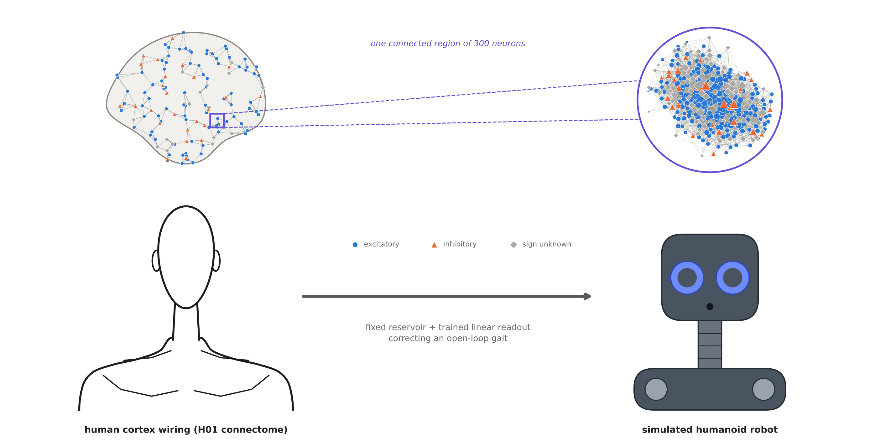
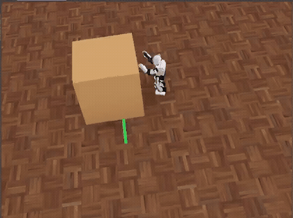
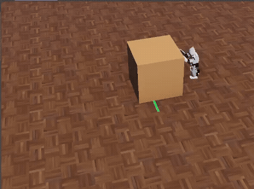
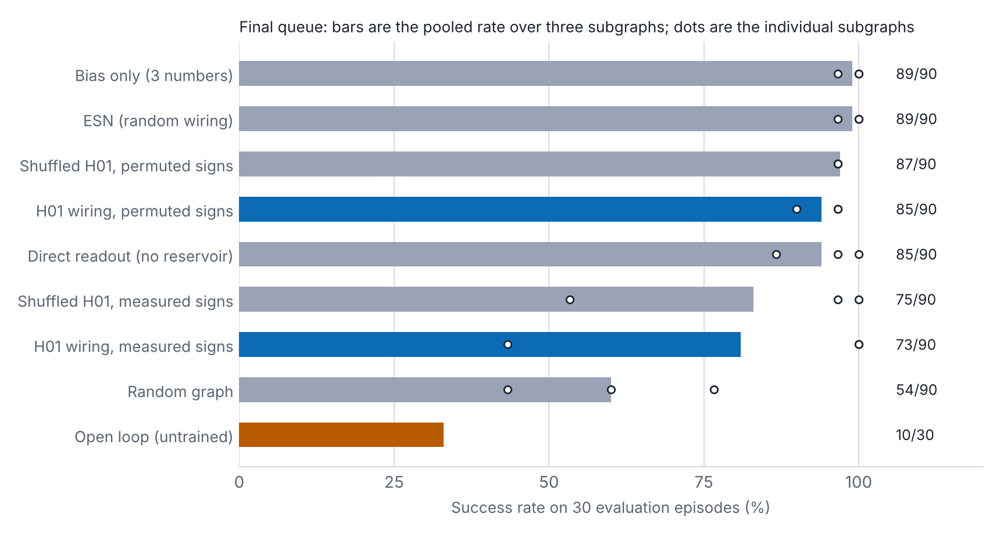
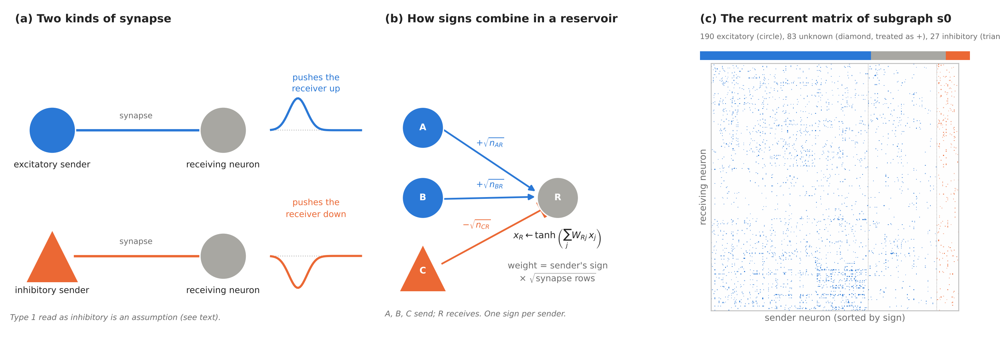
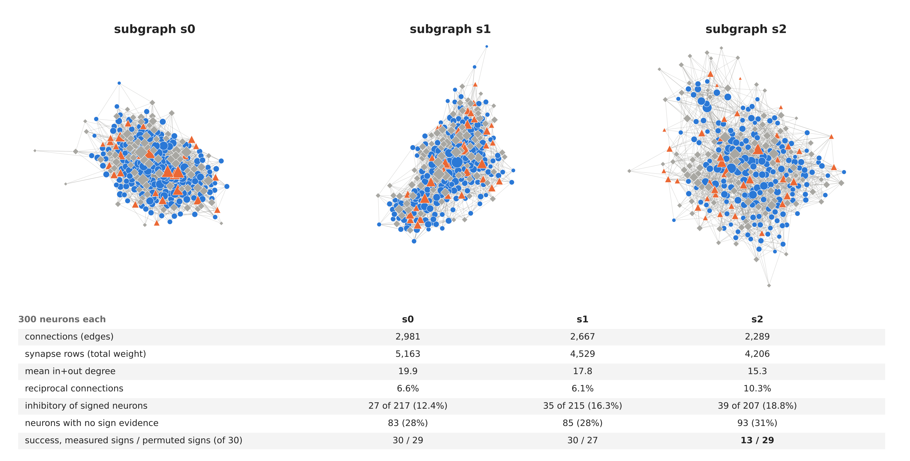
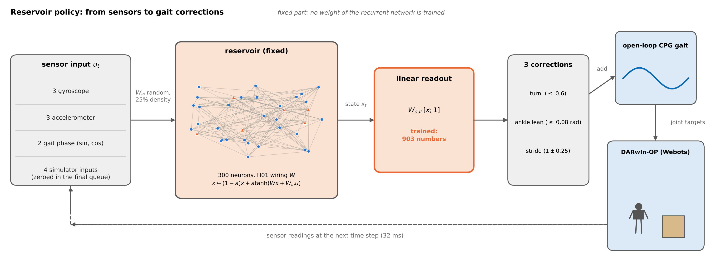
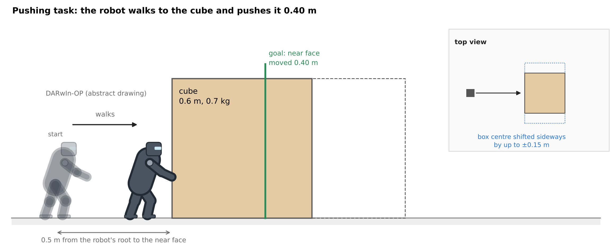
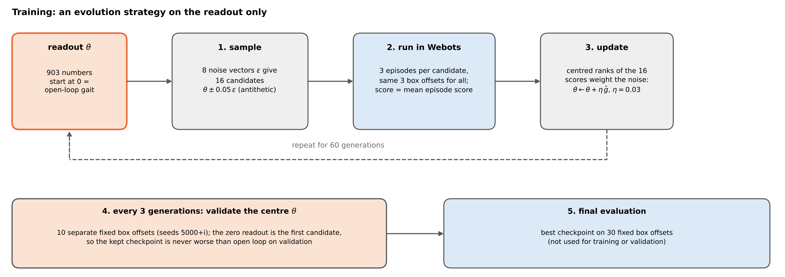

# ExoHominid: A Human Connectome-Structured Reservoir Policy for Robot Learning

**by [Jude Onyenze](https://sites.google.com/view/jude-robotics-researcher/)**  
Department of Mechanical Engineering, University of Texas at Dallas


**Can the wiring of a human cortical microcircuit serve as the recurrent core of a robot controller?**
We took subgraphs of the H01 human temporal-cortex connectome, used each as the fixed recurrent network of a reservoir, and let a trained linear readout add small corrections to the open-loop gait of a simulated DARwIn-OP that pushes a box. Matched controls (degree-preserving shuffles, random graphs, a standard echo-state network, sign policies, a memoryless readout and a constant correction) tell us what the wiring contributes.

[Project page](https://MrO9.github.io/exohominid) · [Portfolio](https://sites.google.com/view/jude-robotics-researcher/) · Paper (bioRxiv, coming soon) · [Project log](LOG.md) · [Reproduce](docs/REPRODUCE.md)



## Videos

Screen recordings from Webots (full-quality MP4s are in [`docs/assets/vid/`](docs/assets/vid/) and on the [project page](https://MrO9.github.io/exohominid#videos)).

| Open-loop baseline | Training run, H01 subgraph |
| --- | --- |
|  |  |

The training recording shows candidate readouts being tried one after another, so it illustrates the behaviour qualitatively; it is not a success count. Success rates are in the table below.

## Status and results

Research code, simulation only (Webots R2025a). Final queue: 0.7 kg box, box offsets ±0.15 m, no simulator-supplied inputs, sensor noise 0.05; 30 evaluation episodes for each of three 300-neuron subgraphs.

| Condition | Successes (of 90) |
| --- | --- |
| Open loop (untrained gait) | 10 / 30 |
| Bias only (3 trained numbers, no reservoir) | 89 |
| Standard ESN | 89 |
| Shuffled H01 wiring, permuted signs | 87 |
| H01 wiring, permuted signs | 85 |
| Direct readout of the 12 inputs, no reservoir | 85 |
| Shuffled H01 wiring, measured signs | 75 |
| H01 wiring, measured signs | 73 |
| Random graph | 54 |



With signs randomised, real and shuffled wiring were indistinguishable (85 vs 87 of 90), and a constant three-number correction matched the best reservoir. The task is specific and easy to train and does not require feedback, so it is not demanding enough to show whether structuring a network on human brain wiring helps. **Next steps:** more refined and more difficult tasks, with conditions that change from episode to episode, using the same controls and the pre-registered protocol (`LOG.md`, sections 42, 45, 51). Per-subgraph numbers and pairwise tests are in [`results/`](results/).

## How it works











## Repository layout

| Path | Contents |
| --- | --- |
| `pipeline/` | Scripts from the H01 synapse tables to the signed neuron graph and subgraphs (standard-library Python) |
| `outputs/graph_v2/` | The derived graph: cells, directed connections, neuron signs |
| `webots/` | Webots world, controller (`reservoir.py`, `policy.py`, `pusher.py`, `h01_dataset_policy.py`, `config.py`), calibrated walker, 100/300/1000-neuron subgraphs |
| `results/` | Final-queue and earlier-queue success counts, pairwise tests |
| `paper/` | LaTeX source of the paper (`paper.tex`, `refs.bib`, `figs/`); upload the folder to Overleaf |
| `figures/` | Scripts that generate the figures (`paper_figs.py` for most; run from inside `figures/`) |
| `docs/` | The project page (GitHub Pages, served from `/docs`), its images and videos, and `REPRODUCE.md` |
| `LOG.md` | Dated, append-only project log, including every failure |

## Quick start

No GPU and no pip packages are needed for the robot experiments; the controller uses only the Python standard library.

1. Install Webots R2025a and open `webots/worlds/push_box.wbt`.
2. In `webots/controllers/h01_dataset_policy/config.py` set `MODE` and save; reset the simulation. Run `"check"`, then `"baseline"`, then `"res_check"`, then `"queue"`.
3. Results appear in `webots/controllers/h01_dataset_policy/results/`.

Full steps, including rebuilding the graph from the raw H01 tables: [`docs/REPRODUCE.md`](docs/REPRODUCE.md).

## Caveats

- Three 300-neuron subgraphs of one cubic millimetre of one brain; the p-values are descriptive.
- Sign labels rest on the assumption that synapse type 1 is inhibitory; 28–31% of neurons per subgraph have no sign evidence and default to excitatory.
- Edge weights are counts of synapse rows, not measured synaptic strengths. Our export has more rows (160.3 M) than the synapse count in the paper (149.9 M); the reason was not established.
- One task in one simulator, with occasional physics instability (handled by automatic detection and world reload).
- No claim is made about whole-brain emulation, consciousness or reconstructing a person.

## Data and licences

Code: MIT (see `LICENSE`). Data: H01 was released by Shapson-Coe et al. (Harvard and Google); we did not create it and do not redistribute the raw tables. `outputs/` and `webots/subgraphs/` are small derived tables computed from the public c3 synapse export; please cite the H01 paper and check the dataset's own terms at its release page. `webots/controllers/h01_dataset_policy/darwin_rl.py` and `darwin_state.json` are the calibrated DARwIn-OP walker from our earlier work.

## Citation

```bibtex
@misc{onyenze2026exohominid,
  author = {Onyenze, Jude},
  title  = {ExoHominid: A Human Connectome-Structured Reservoir Policy for Robot Learning},
  year   = {2026},
  note   = {Preprint in preparation. Code: https://github.com/MrO9/exohominid}
}
```

Shapson-Coe, A. et al. A petavoxel fragment of human cerebral cortex reconstructed at nanoscale resolution. *Science* 384, eadk4858 (2024).

## Acknowledgements

We thank the H01 authors for releasing the dataset. The project page layout is inspired by the [Open-TeleVision](https://robot-tv.github.io/) page.
